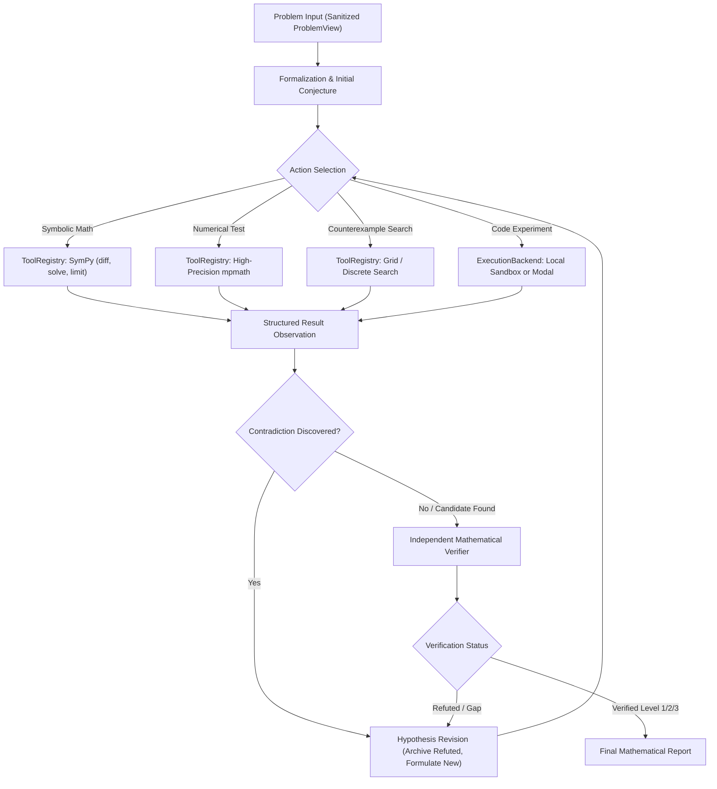

# MIA Architecture and Design

The **Mathematical Investigation Agent (MIA)** is an autonomous research system designed to explore mathematical problems through iterative reasoning, programmatic experiments, counterexample search, and mathematical verification.

Unlike static pipelines that perform predetermined execution steps, MIA implements an adaptive state machine where the agent determines its next action dynamically based on accumulated evidence, observation of execution results, and hypothesis contradiction.

## Architectural Separation of Concerns

The repository enforces strict separation across 10 core components:

1. **`ProblemSource` (`src/mia/sources/`)**:
   Acquires, normalizes, and caches mathematical problems from official sources (IMO, Hugging Face MATH, and controlled benchmarks). Separates reference answers from solving agents via `to_agent_view()`.
2. **`Agent` (`src/mia/agent/`)**:
   Coordinates the investigation loop, tracks hypotheses, enforces resource limits (steps, wall-clock duration, model calls, nonproductive steps), and detects repeated actions.
3. **`ModelClient` (`src/mia/llm/`)**:
   Unified LLM client supporting tool calling across OpenAI, Anthropic, Gemini, and a deterministic offline `MockDeterministicClient`.
4. **`ToolRegistry` (`src/mia/tools/`)**:
   Type-safe registry validating inputs against Pydantic models and generating OpenAI and Anthropic JSON schemas.
5. **`ExecutionBackend` (`src/mia/execution/`)**:
   Subprocess sandbox (`LocalExecutionBackend`) and serverless cloud execution (`ModalExecutionBackend`) behind a common interface.
6. **`Verifier` (`src/mia/verification/`)**:
   Independent mathematical verification separating empirical computational evidence (Level 1), exact symbolic reduction (Level 2), and proof step structure checks (Level 3).
7. **`ExperimentStore` (`src/mia/storage/`)**:
   SQLite database (`runs/mia.db`) and append-only JSONL event stream (`runs/traces/`).
8. **`EvaluationRunner` (`src/mia/evaluation/`)**:
   Evaluates benchmark problems across experimental conditions (Config A: Reasoning baseline, Config B: Stateless tools, Config C: Persistent adaptive agent).
9. **`Reporter` (`src/mia/reporting/`)**:
   Generates human-readable Markdown reports and traces without re-running expensive compute.
10. **`CLI` (`src/mia/cli.py`)**:
    Command-line interface built with Typer and Rich.
